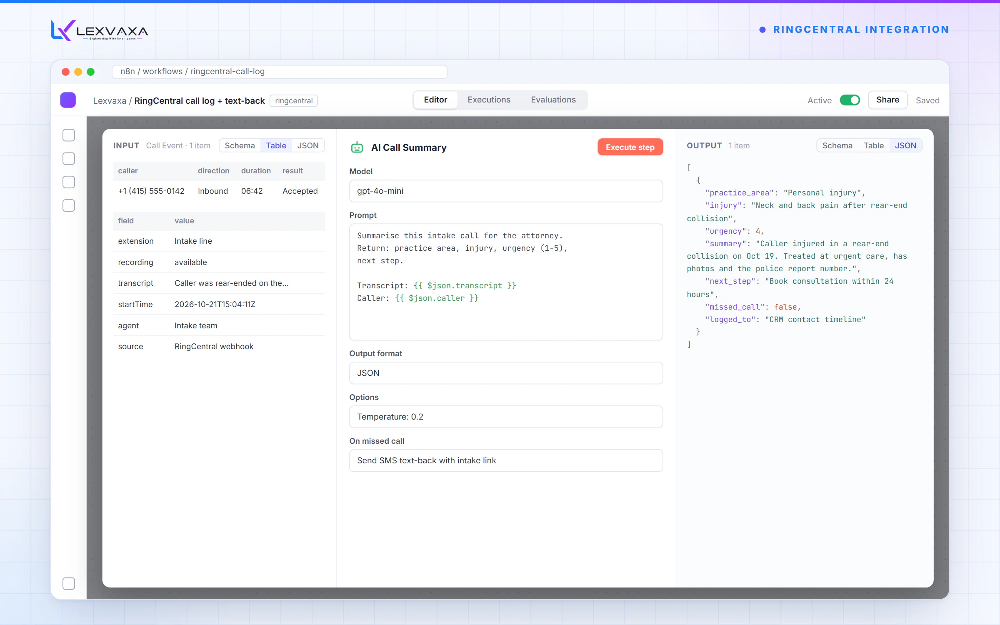

# RingCentral Call Logging & Missed-Call Text-Back

**Every intake call is summarised by AI and logged to the CRM, and every missed caller gets an instant text with an intake link.**

       

## Overview

Calls were not logged consistently, and a missed caller could easily go to another firm. Lexvaxa built a custom Node.js integration on RingCentral webhooks, with n8n handling the CRM and SMS steps. Every call event is logged to the CRM contact timeline, an AI model turns the transcript into structured call notes with practice area, urgency and next step, missed calls get an instant SMS text-back, and new callers receive an intake link. Screens shown use sample data, so no client records are exposed.

## The challenge

Busy intake lines meant missed calls and inconsistent notes, and potential clients were lost before anyone called back.

## The solution

A Node.js webhook service for RingCentral with n8n workflows for AI call summaries, CRM logging, SMS text-back and team alerts.

## Key features

- Every call event logged to the CRM contact timeline
- AI call notes: practice area, injury, urgency, next step
- Instant SMS text-back for missed calls
- Intake link sent to new callers
- Alerts to the intake team for urgent calls

## Results

- Every call is recorded and no potential client is left without a reply

## Tech stack

Node.js · RingCentral API · n8n · OpenAI · CRM API · SMS · Webhooks

## Demo

A working version of the dashboard UI with **sample data** is in [`demo/index.html`](demo/index.html). Download it and open it in a browser; it has no build step.

## Privacy

Client names and records are confidential. Every screen in this repository uses sample data, and source code that belongs to the client is not published.

## Links

- Case study on Lexvaxa: https://lexvaxa.com/work/ringcentral-call-logging-text-back
- Built by **Ch Muhammad Samiullah** ([GitHub](https://github.com/samiullah156-creator)) at [Lexvaxa](https://lexvaxa.com)
